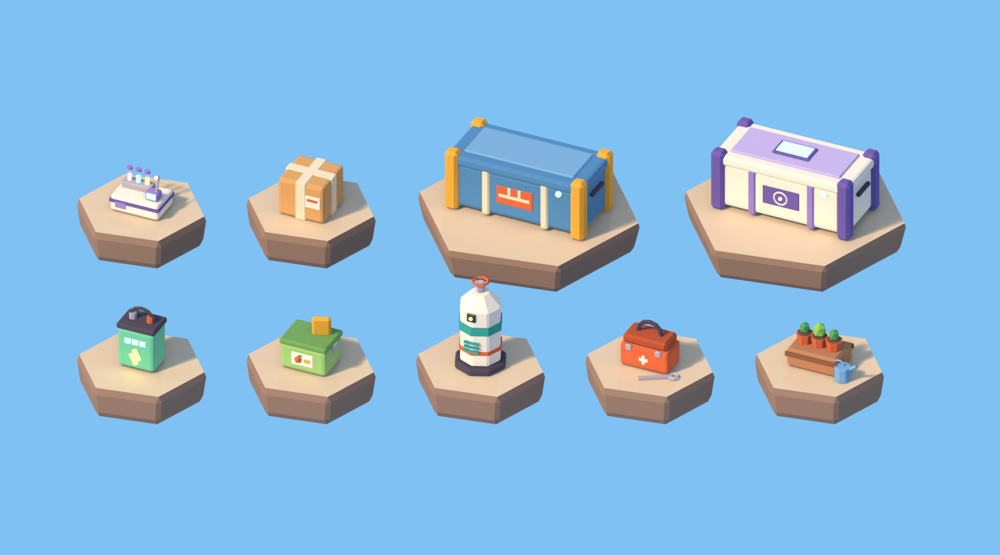
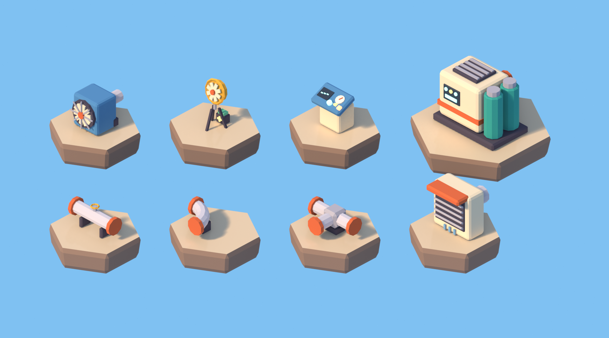
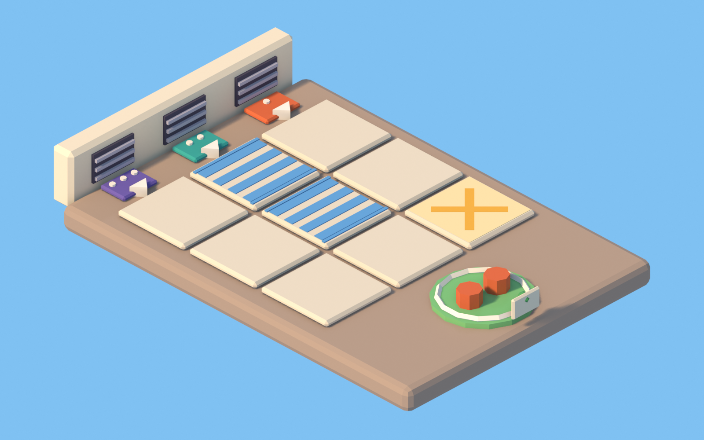
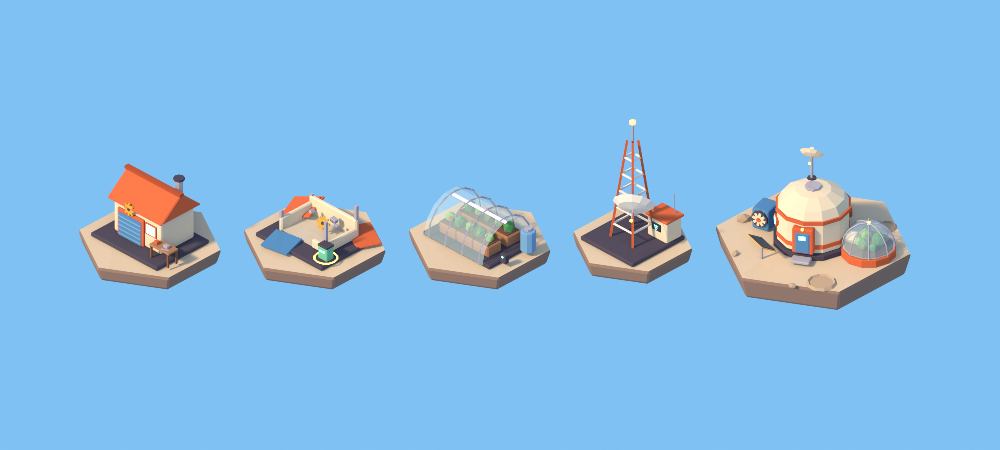
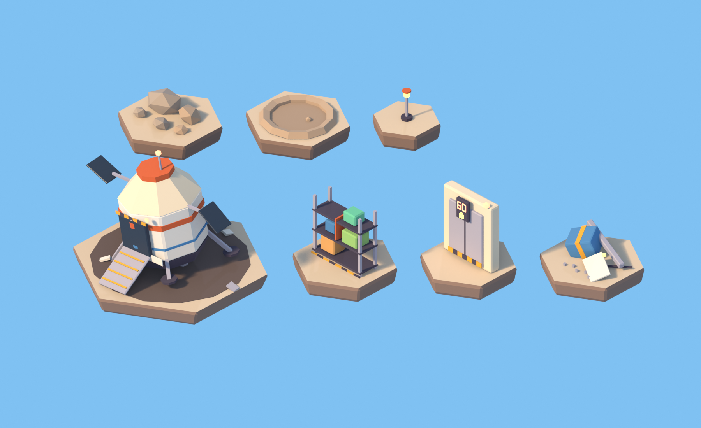

# 05 · Asset Catalog

There are 34 assets, and every one is exported as its own `.glb`. Triangle counts are measured after bevels are applied. Paths are relative to `moonshift_early/exports/`.

## Characters: `01_Characters/`

| Asset | File | Tris | Gameplay role / notes |
|---|---|---|---|
| B.E.E.P. robot | `MOONSHIFT_CHR_BEEP_Robot.glb` | 1,604 | Player character. Treads, visor face, antenna, back carry rack (*rak angkut*) with box and battery |
| Crew A | `MOONSHIFT_CHR_Crew_A.glb` | 1,356 | White suit, terracotta accent, teal chest light |
| Crew B | `MOONSHIFT_CHR_Crew_B.glb` | 1,356 | Mustard suit, blue accent, amber chest light |
| Crew C | `MOONSHIFT_CHR_Crew_C.glb` | 1,356 | Mint suit, purple accent, pink chest light |

## Cargo items: `02_Items/`

| Asset | File | Tris | Footprint | Design-doc item |
|---|---|---|---|---|
| Portable battery | `MOONSHIFT_ITM_Battery_Portable.glb` | 328 | 1 tile | *Baterai portabel*: +1 power unit for 1 shift |
| Food pack | `MOONSHIFT_ITM_Food_Pack.glb` | 372 | 1 tile | *Paket makanan*: adds supplies immediately |
| Air processing component | `MOONSHIFT_ITM_Air_Component.glb` | 452 | 1 tile | *Komponen pemrosesan udara* |
| Maintenance kit | `MOONSHIFT_ITM_Maintenance_Kit.glb` | 400 | 1 tile | *Kit perawatan*: keeps the workshop working |
| Garden kit | `MOONSHIFT_ITM_Garden_Kit.glb` | 448 | 1 tile | *Kit kebun* |
| Research equipment | `MOONSHIFT_ITM_Research_Equipment.glb` | 524 | 1 tile | *Perlengkapan penelitian* |
| Small crate | `MOONSHIFT_ITM_Crate_Small_1Tile.glb` | 220 | **1 tile** | *Paket kecil* |
| Long crate | `MOONSHIFT_ITM_Crate_Long_2Tile.glb` | 720 | **2 tiles**, rotatable | *Peti panjang* |
| Large research crate | `MOONSHIFT_ITM_Crate_Research_Large_2Tile.glb` | 920 | **2 tiles**, rotatable | *Peti penelitian besar* (the debrief example) |

## Air system and puzzle: `03_AirSystem/`

| Asset | File | Tris | Notes |
|---|---|---|---|
| Pipe, straight | `MOONSHIFT_AIR_Pipe_Straight.glb` | 280 | 1 tile, along X, valve on top |
| Pipe, corner | `MOONSHIFT_AIR_Pipe_Corner.glb` | 236 | Connects the left edge to the front edge |
| Pipe, T | `MOONSHIFT_AIR_Pipe_T.glb` | 268 | Left, right and front outputs |
| Vent inlet | `MOONSHIFT_AIR_Vent_Inlet.glb` | 296 | *Saluran masuk*: louvres, arrows, duct |
| Branch fan | `MOONSHIFT_AIR_Fan_Branch.glb` | 396 | *Kipas cabang*: integrated fan with power box |
| Portable fan | `MOONSHIFT_AIR_Fan_Portable.glb` | 384 | *Kipas portabel*: tripod plus battery slot (needs +1 power) |
| Air regulator | `MOONSHIFT_AIR_Air_Regulator.glb` | 344 | *Pengatur udara*: dial, screen, and circle / triangle / square buttons (tap-friendly, no fast needle) |
| Main air unit | `MOONSHIFT_AIR_Main_Air_Unit.glb` | 692 | *Sistem udara utama*: 2 tanks, top grille, status lights |
| Placement board 3×3 | `MOONSHIFT_AIR_Placement_Board_3x3.glb` | 1,520 | Inlet on the left, crew zone on the right, routes top/middle/bottom (1/2/3 dots), vent zones (stripes), service access (X) |

## Facilities: `04_Facilities/`

| Asset | File | Tris | Notes |
|---|---|---|---|
| Habitat module | `MOONSHIFT_FAC_Habitat_Module.glb` | 2,270 | Dome hab, airlock, windows, attached garden dome, radio dish, vent fan, solar panel |
| Workshop (intact) | `MOONSHIFT_FAC_Workshop_Intact.glb` | 744 | *Bengkel*: Outlanders-style house, roll door, gear sign, workbench |
| Workshop (dismantled) | `MOONSHIFT_FAC_Workshop_Dismantled.glb` | 944 | After *Bongkar*: low walls, fallen roof and door, scrap, **salvaged battery** with an amber ring |
| Garden facility | `MOONSHIFT_FAC_Garden_Facility.glb` | 874 | *Kebun kecil*: 2 raised beds, glass tunnel, pink grow lamp, water tank, power box |
| Radio station | `MOONSHIFT_FAC_Radio_Station.glb` | 678 | *Radio/beacon*: lattice tower, dish, red beacon, equipment hut |

## Opening and environment: `05_Opening_Environment/`

| Asset | File | Tris | Notes |
|---|---|---|---|
| Cargo lander (damaged) | `MOONSHIFT_ENV_Cargo_Lander_Damaged.glb` | 988 | Broken leg, ~6° lean, open cargo ramp, hazard stripes, scorch mark, debris |
| Cargo bay rack | `MOONSHIFT_ENV_Cargo_Bay_Rack.glb` | 464 | 3-shelf rack with mixed boxes |
| Door lock timer panel | `MOONSHIFT_ENV_Door_Lock_Timer_Panel.glb` | 552 | Compartment door, red "60" display, padlock icon, warning lamp |
| Debris / obstacles | `MOONSHIFT_ENV_Debris_Obstacles.glb` | 348 | Fallen crate, beam, bent panel, bolts, spark |
| Rocks | `MOONSHIFT_ENV_Terrain_Rocks.glb` | 100 | Rock cluster |
| Crater | `MOONSHIFT_ENV_Terrain_Crater.glb` | 184 | Rim, floor, pebble |
| Path light | `MOONSHIFT_ENV_Terrain_PathLight.glb` | 104 | Small amber lamp post |

## Legacy files (first pass)

`exports/MOONSHIFT_01_BEEP_Robot.glb`, `MOONSHIFT_02_Cargo_Set.glb` and `MOONSHIFT_03_Habitat_Module.glb` are from the first version. The Cargo Set is a showcase group (long crate, package, food pack and canister together). Prefer the per-asset files in the category folders.

## Not built yet (suggested next)

- An assembled **base map** scene (one island with all facilities and the 3×3 board)
- **Cargo bay interior** shell (walls and floor) for the 60-second opening
- State variants: garden powered / unpowered, radio broken / repaired, fan on / off (spin animation)
- UI icons rendered from these models (item cards for the cargo-selection screen)
