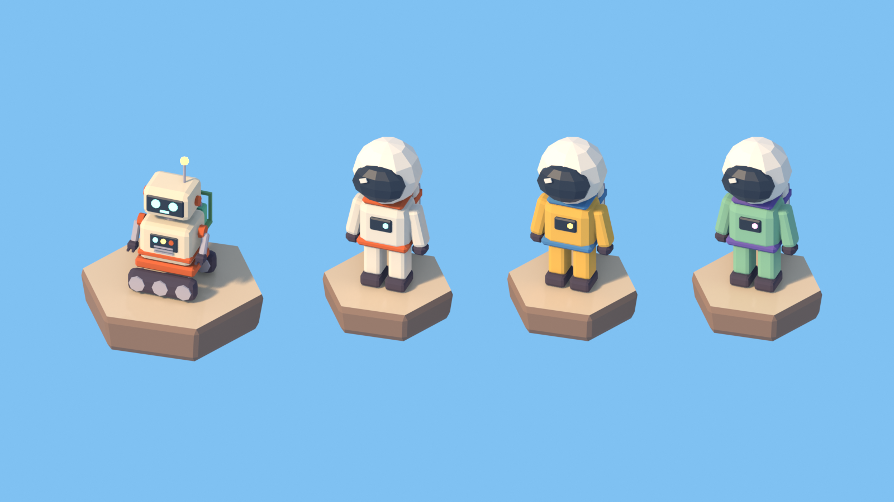
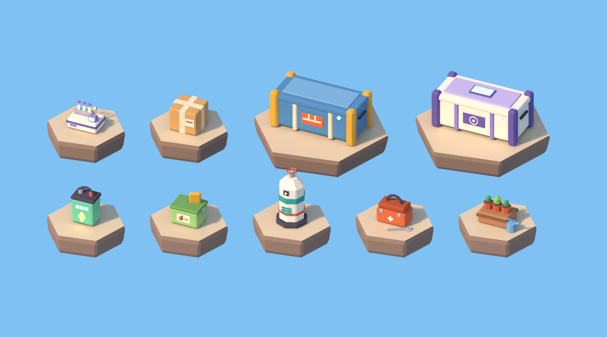
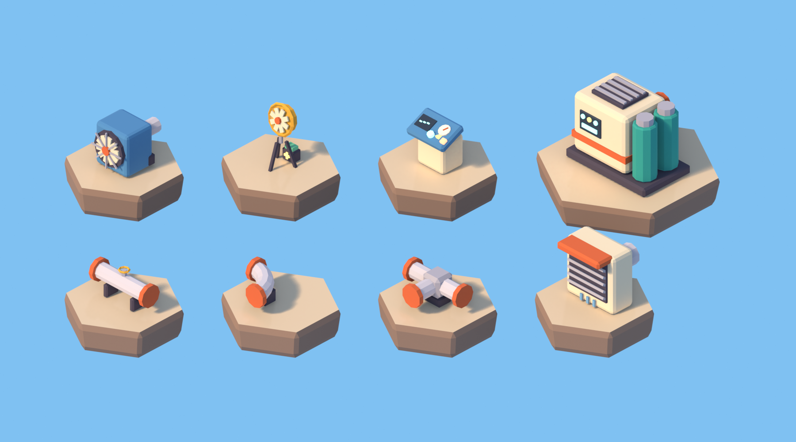
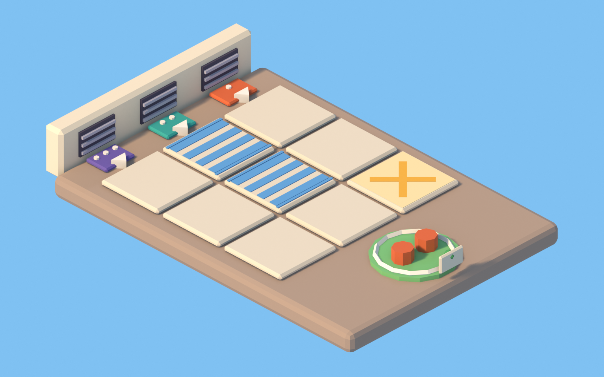
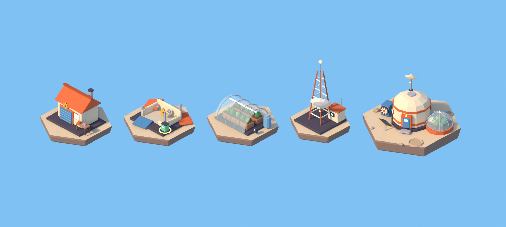
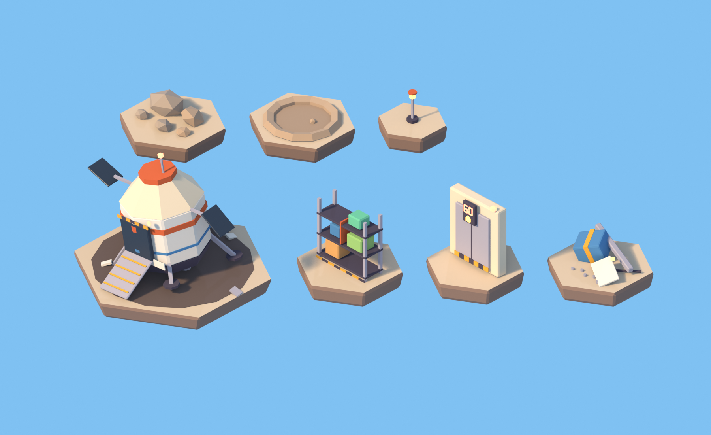

# MOONSHIFT: Visual Design Theme ("Outlanders style")

This folder is the art-direction and production guide for MOONSHIFT's 3D look. It describes the low-poly style used for all 34 assets in `MOONSHIFT_assets.blend`. The style is inspired by Pomelo Games' *Outlanders*, adapted to a lunar base.

The goal is that anyone (an artist, developer or AI agent) can make a new asset that fits next to the existing ones without guessing.

## Files

| File | What it covers |
|---|---|
| [01_art_direction.md](01_art_direction.md) | Style pillars, what we took from Outlanders, mood, readability for kids 7–12, do / don't |
| [02_color_palette.md](02_color_palette.md) | Every colour (hex), what it is used for, glow-colour meanings, item colour coding |
| [03_modeling_guide.md](03_modeling_guide.md) | Shape language, bevels, flat shading, scale and grid, proportions, polygon budgets |
| [04_lighting_and_rendering.md](04_lighting_and_rendering.md) | Blender scene setup: EEVEE, sky/world trick, sun and fill, camera, render settings |
| [05_asset_catalog.md](05_asset_catalog.md) | All 34 assets: purpose in gameplay, triangle count, file path |
| [06_pipeline_naming_export.md](06_pipeline_naming_export.md) | Collections and naming, helper scripts, display tiles, GLB export rules, checklist |

## The style in one paragraph

Chunky, toy-like objects made from simple primitives with **chamfered (bevelled) edges and flat shading**. A **warm, saturated palette** (cream, terracotta orange, mustard, sky blue) sits on **warm sand-coloured lunar ground**. Everything is lit by a **low warm sun with soft shadows** against a **bright sky-blue backdrop**. There are no textures; colour comes only from flat materials. Small **glowing details** (eyes, lights, screens) carry status and personality. Every asset should read clearly from a high isometric camera at small size.

## Quick reference

| Thing | Value |
|---|---|
| Engine (preview) | Blender 5.1, EEVEE |
| Colour management | View Transform **Standard**, Look **None**, Exposure 0 |
| Background (camera sees) | `#7FC1F2` |
| Ambient (lighting) | `#AFC9EA` × 0.75 |
| Key light | Sun `#FFE2B8`, strength 3.6, angle 6°, rotation (52°, 0°, −10°) |
| Camera | Orthographic, isometric-style, looking from (+X, −Y, up) |
| Shading | Flat, no textures, roughness 0.85 (default) |
| Bevel | Bevel modifier, segments 1–2, angle limit 40° |
| Grid | 1 placement tile ≈ 1.0 m (tile pitch 1.05 m) |
| Export | glTF 2.0 binary (`.glb`), modifiers applied, origin at the asset's ground centre |

## Preview renders

Contact sheets are in `../renders/`:

- 
- 
- 
- 
- 
- 

> Outlanders is a trademark of Pomelo Games. It is used here only as a style reference. MOONSHIFT assets are original models and must not copy Outlanders' characters, buildings or UI.
